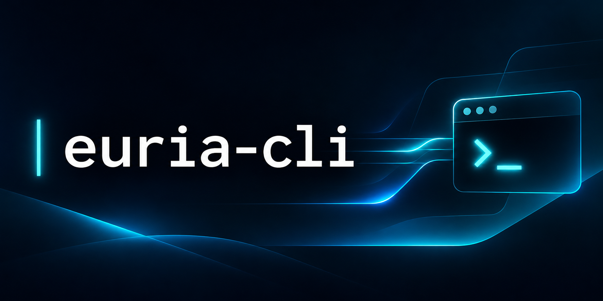

<p align="center">
  
</p>

# Euria CLI

A Go command-line client for Euria (Infomaniak). Reuses a signed-in browser session or runs in guest mode.

## Install

Linux / macOS:

```sh
curl -fsSL https://raw.githubusercontent.com/benoitpetit/euria-cli/main/install.sh | sh
```

Windows (PowerShell):

```powershell
irm https://raw.githubusercontent.com/benoitpetit/euria-cli/main/install.ps1 | iex
```

The installer detects your OS and architecture, verifies the SHA-256 checksum, and installs `euria` to `~/.local/bin` (Linux/macOS) or `%LOCALAPPDATA%\euria\bin` (Windows). To install manually, download a release asset from [GitHub Releases](https://github.com/benoitpetit/euria-cli/releases) and run `./euria --help`. To build from source: `git clone ... && make build && make install` (Go 1.25+).

Self-update: `euria update` (or `euria update v0.0.6`).

## Platforms and browsers

Runs on Linux, Windows, and macOS. Browser support:

| Family | Linux | Windows | macOS |
|---|---|---|---|
| Chrome, Chromium, Edge, Brave, Vivaldi, Opera, Whale | Yes | Yes | Yes |
| Firefox, Zen, Floorp, Waterfox, LibreWolf | Yes | Yes | Yes |
| Arc, Comet | — | Yes | Yes |
| Dia, ChatGPT Atlas, Safari | — | — | Yes |
| Helium | — | — | Yes (explicit) |

Cookie support comes from [Sweetcookie](https://github.com/steipete/sweetcookie). Some browser versions or profile layouts may not be readable. On Windows, recent Chromium builds can use app-bound encryption that blocks cookie decryption. A keyring prompt may appear when cookies are protected by OS credentials.

`auth login` opens the system browser (`xdg-open` / `open` / URL handler). That browser may differ from the cookie source you selected. Sign in in the selected browser and profile, or open `https://euria.infomaniak.com` there.

Alternatively, read cookies from a browser exposing a Chrome DevTools Protocol endpoint:

```sh
chromium --remote-debugging-port=9222 --user-data-dir=/tmp/euria-profile
euria auth status --cdp http://localhost:9222
```

## Sign in

```sh
euria auth login
euria auth status
euria auth status --browser chrome --profile "Profile 2"
euria auth status --browser chrome --browser firefox
```

By default one profile per browser is checked: `Default` for Chromium-family browsers, `default-release` for Firefox-family browsers, and the system cookie store for Safari. Use `--browser` to select sources and `--profile` with exactly one browser to pick another profile. `--chrome-profile` is a compatibility alias.

If no session is found, `auth login` opens the sign-in page. For a one-off prompt without an account, use guest mode (subject to Euria's guest quota):

```sh
euria --guest --chat "Hello!"
```

## Usage

With no arguments, `euria` prints help. A prompt on stdin starts a chat:

```sh
euria
cat prompt.txt | euria --output json
```

Authenticated chat is the default:

```sh
euria --chat "Explain how DNS works in one paragraph."
euria --chat "Give me three vegetarian lunch ideas." --model fast
euria --chat "Find recent documentation about Go contexts." --web-search on --output json
```

JSON output includes the answer and conversation ID:

```sh
euria --chat "Reply with the word OK." --output json
# {"answer":"OK","conversation_id":"<conversation-id>"}
```

Continue a conversation:

```sh
euria --chat "Can you give an example?" --conversation <conversation-id>
```

Guest chat:

```sh
euria --guest --chat "What causes the northern lights?"
euria --guest --chat "Explain DNS in one paragraph." --output json | jq -r '.answer'
```

Guest models: `fast`, `expert`, `apertus` (the public endpoint maps `expert` to `fast`). Web search: `auto` (`web_search`), `on` (`web_search_forced`), `off`. Guest history can be supplied as a JSON array via `--history`; authenticated conversations use server-side history.

Thinking mode and tools:

```sh
euria --chat "Solve this." --thinking --tool wiki_search --tool create_pdf
```

Ephemeral chat (no saved conversation):

```sh
euria --chat "Quick question" --ephemeral
```

Streaming output:

```sh
euria --chat "Write a long answer." --stream
```

Conversations:

```sh
euria conversations
euria conversations search "DNS"
euria conversations --archived
euria conversations --favorites
euria conversation show CONVERSATION_ID
euria conversation rename CONVERSATION_ID "New title"
euria conversation archive CONVERSATION_ID
euria conversation unarchive CONVERSATION_ID
euria conversation favorite CONVERSATION_ID
euria conversation unfavorite CONVERSATION_ID
euria conversation share CONVERSATION_ID
```

Audio and voice:

```sh
euria --guest --audio recording.webm --language en
euria --audio recording.webm --account 12345
euria --guest --voice
euria --voice --chat "Summarize this:"
```

Euria accepts `video/mp4`, `video/webm`, `audio/webm`, `audio/mp4`. Convert with `ffmpeg -i input.wav -c:a libopus output.webm`. `--voice` needs `sox`/`rec`, `arecord`, or `ffmpeg`.

## Options

| Option | Values | Default | Description |
|---|---|---|---|
| `auth login` | `--browser`, `--profile` | — | Reuse a session or open sign-in and wait. |
| `auth status` | `--browser`, `--profile` | — | Check for a valid session. |
| `--chat` | `MSG` | — | Send one prompt (stdin if omitted). |
| `--guest` | — | off | Anonymous public endpoint. |
| `--model` | `fast`, `expert`, `apertus` | `fast` | Select a model. |
| `--web-search` | `auto`, `on`, `off` | `auto` | Web search mode. |
| `--history` | `FILE` | — | Guest history JSON. |
| `--output` | `text`, `json` | `text` | Output format. |
| `--browser` | name (repeatable) | automatic | Browser sources: `chrome`, `chromium`, `edge`, `brave`, `vivaldi`, `opera`, `arc`, `helium`, `dia`, `comet`, `atlas`, `whale`, `firefox`, `zen`, `floorp`, `waterfox`, `librewolf`, `safari`. |
| `--profile` | `NAME` or path | browser default | Profile for one browser. |
| `--chrome-profile` | `NAME` or path | browser default | Alias for `--profile`. |
| `--account` | `ID` | automatic | Select an account. |
| `--conversation` | `ID` | new | Continue a conversation. |
| `--thinking` | — | off | Enable thinking mode. |
| `--project` | `ID` | — | Associate conversation with a project. |
| `--tool` | `NAME` (repeatable) | — | `web_search`, `web_search_forced`, `faq_search`, `wiki_search`, `create_pdf`. |
| `--ephemeral` | — | off | Ephemeral chat (no saved conversation). |
| `--stream` | — | off | Stream deltas (text). |
| `--audio` | `FILE` | — | Transcribe an audio file as the prompt. |
| `--voice` | — | off | Record and transcribe from the microphone. |
| `--language` | `CODE` | from `LANG` or `en` | Transcription language. |
| `--archived` | — | off | List archived conversations. |
| `--favorites` | — | off | List favorite conversations. |
| `--cdp` | `URL` | — | Read cookies via a CDP endpoint. |
| `--login-timeout` | `DUR` | `5m` | Max wait for sign-in. |
| `--list-models` | — | — | Print supported models. |
| `--version` | — | — | Print version. |
| `-h`, `--help` | — | — | Show usage. |

`--history` requires `--guest`. `--account`, `--conversation`, `--project`, `--ephemeral` require authenticated mode. With no arguments and empty stdin, the CLI prints help.

## Privacy and service behavior

- Prompts and authenticated conversation contents are sent to Infomaniak. Authenticated conversations are saved in the signed-in account; this CLI does not delete them.
- Cookie values and the XSRF token stay in process memory and are sent only to the Euria HTTPS origin. Chromium and Firefox databases are read from temporary snapshots; session data is not saved by the CLI.
- Guest mode sends no cookies or XSRF token. Euria reports a guest limit of five messages per day, but the service controls the quota.
- Chat POST requests are never retried automatically. A connection can fail after Euria has accepted a prompt, and a retry could create a duplicate conversation.
- The account and guest routes are private web-client endpoints observed during reverse engineering, not a documented public API. Euria can change them at any time.

## Development

```sh
make check
make test
make build
bin/euria --help
bin/euria --list-models
```

`make check` runs `gofmt` and `go vet`. `make test` runs the local Go suite without contacting Euria. A live prompt contacts the selected account or guest endpoint.